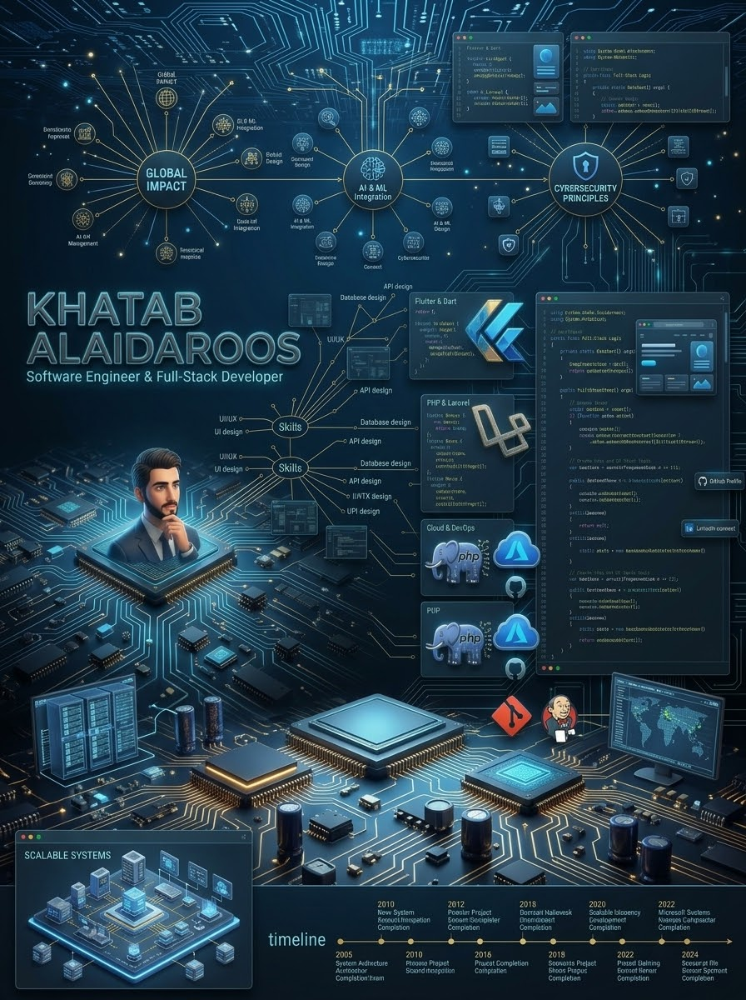

  

  

  <h1>👋 أهلاً وسهلاً بك! | Welcome!</h1>
  
<i>سعيد بزيارتك لملفي الشخصي — تصفح أدناه للتعرف على خبراتي ومشاريعي.</i>

  
<i>Glad you stopped by — scroll down to explore my work and skills.</i>

  <h3>Software Engineer & Full-Stack Web & Mobile Developer 💻</h3>
  
<i>Building scalable web applications, mobile apps & writing clean, efficient code.</i>

  
  

  
  
  

   
  

 

<h2 align="center">🚀 Featured Projects | المشاريع المميزة</h2>

  
  
    
  
  

<h2 align="center">🏆 Certifications & Achievements | الشهادات والإنجازات</h2>

  <table>
    <tr>
      <td align="center" width="50%">
         
        <b>Meta / Coursera</b> — 2024
      </td>
      <td align="center" width="50%">
         
        <b>Google Developers</b> — 2024
      </td>
    </tr>
    <tr>
      <td align="center" width="50%">
         
        <b>Amazon Web Services</b> — 2023
      </td>
      <td align="center" width="50%">
         
        <b>IBM / Coursera</b> — 2023
      </td>
    </tr>
  </table>

 

<h2 align="center">📈 Recent Activity | آخر التحديثات</h2>

  

 

<h2 align="center">👨‍💻 About Me</h2>

  

    Passionate <b>Software Engineer</b> specialized in building robust Web and Mobile applications. 
    I love turning complex problems into simple, beautiful, and intuitive solutions. Experienced in backend architecture, cross-platform mobile development, and crafting seamless user interfaces.
  

 

<h2 align="center">🛠️ Languages, Frameworks & Tech Stack</h2>

  <h4>💻 Programming Languages</h4>
  
  
  
  
  
  
    

  <h4>🌐 Web & Frontend Development</h4>
  
  
  
  

    

  <h4>📱 Mobile App Development</h4>
  

    

  <h4>🛠️ Tools & Platforms</h4>
  
  
  
  
  

 

<h2 align="center">📊 GitHub Analytics</h2>

  
  

   
  

 

<h2 align="center">📬 Contact Me | تواصل معي</h2>

  
💬 <b>هل لديك مشروع أو فرصة عمل؟ لا تتردد في التواصل معي!</b>

  
<i>Have a project or job opportunity? Feel free to reach out!</i>

  <table>
    <tr>
      <td align="center">
        <a href="mailto:khatabalaidarous@gmail.com">
           
        </a>
      </td>
    </tr>
    <tr>
      <td align="center">
        <a href="https://linkedin.com/in/YOUR-LINKEDIN-USERNAME">
           
        </a>
      </td>
    </tr>
    <tr>
      <td align="center">
        <a href="https://github.com/khatabalaidarous">
           
        </a>
      </td>
    </tr>
  </table>
   
  

 

  
  
<i>⭐ Thanks for visiting! | شكراً لزيارتك!</i>

